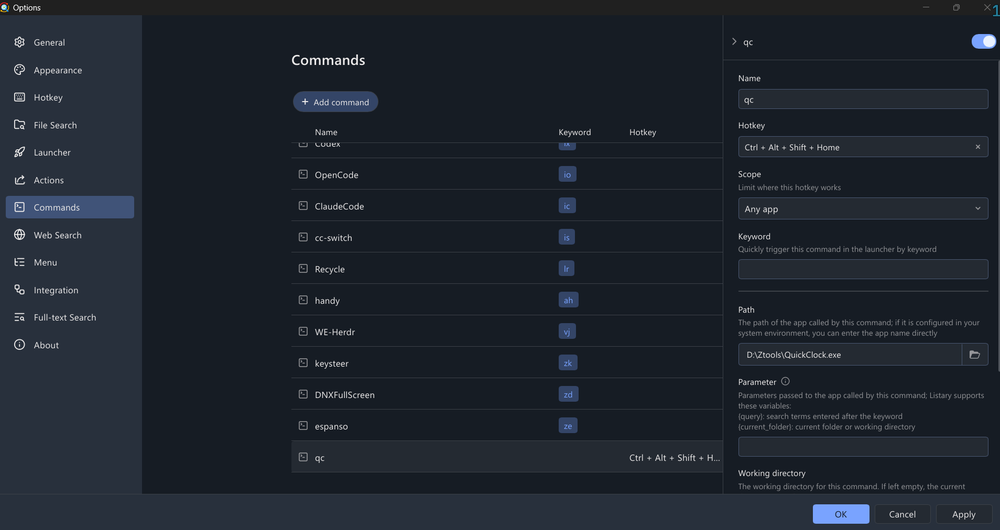

# QuickClock ⏱️

English | [简体中文](README.zh-CN.md)


A fullscreen clock that appears the instant you need it. Bind it to a keyboard
shortcut, press it, see the time — press <kbd>ESC</kbd> or <kbd>Q</kbd> and it's gone.


## Why

The original [QuickClock](https://github.com/ZXTube/QuickClock) was a
Python/pygame app. Great idea — but the Python runtime made it heavier than a
clock needs to be: a 14–28 MB distribution, a packaging pipeline, and a startup
delay you can feel. This is a from-scratch Rust rewrite with the same soul and
none of the weight:

| | Python version | QuickClock (Rust) |
|---|---|---|
| Distribution | 14.6 MB onefile / 28 MB folder | **single 0.72 MB exe** |
| Startup | extracts to temp, loads interpreter | **~instant** |
| Dependencies | Python + venv + PyInstaller | **none** |
| Idle CPU | event loop @ 20 fps | **~0%** (wakes once per second) |

## Features

- ⏰ Time `HH:MM:SS` in Consolas, centered — digits don't shift as they tick
- 📅 Date and weekday in Microsoft YaHei, bottom center
- 🌏 Always local time (no UTC surprises)
- 🖥️ True fullscreen, DPI-aware font scaling
- 🔂 Single instance — pressing the shortcut again *raises* the running window
- 🚀 No console window, no white flash, no installer

## Getting started

Build from source (Rust toolchain, MSVC):

```bash
cd rust
cargo build --release
```

Your executable is `rust/target/release/QuickClock.exe` — one file, zero
dependencies. Copy it anywhere.

## Launching it your way

**Option 1 — Windows shortcut hotkey.** Put a shortcut to it on your desktop,
open the shortcut's Properties, and set a *shortcut key*
(e.g. <kbd>Ctrl</kbd>+<kbd>Alt</kbd>+<kbd>T</kbd>).

**Option 2 — Listary.** If you use [Listary](https://www.listary.com), you can
also set up a quick-launch hotkey for QuickClock as shown below:



From then on the clock is one keypress away, and <kbd>ESC</kbd> or <kbd>Q</kbd> dismisses it.

## Design notes

- **Event-driven rendering** — `winit` wakes exactly at each second boundary;
  nothing spins between ticks
- **Software rendering** — `softbuffer` + `ab_glyph` rasterization: no GPU
  stack, no framework, deterministic on every machine
- **Font fallback chains** — Consolas → Lucida Console; Microsoft YaHei →
  msyh.ttf → SimHei; a fatal error dialog only if every fallback fails
- **Robust window lifecycle** — created hidden, revealed after the first frame
  is painted (no startup flash); transient surface failures skip a frame
  instead of crashing

Spec and implementation plan live under [`docs/`](docs/).

## Development

```bash
cd rust
cargo test    # 13 unit tests: time formatting, font fallback, rasterizer, layout
cargo run     # debug build
```

## Acknowledgements

Forked in spirit from [ZXTube/QuickClock](https://github.com/ZXTube/QuickClock)
(Python/pygame). The Rust implementation is a complete rewrite.

## License

[MIT](LICENSE) © 2026 zczsyqxl
