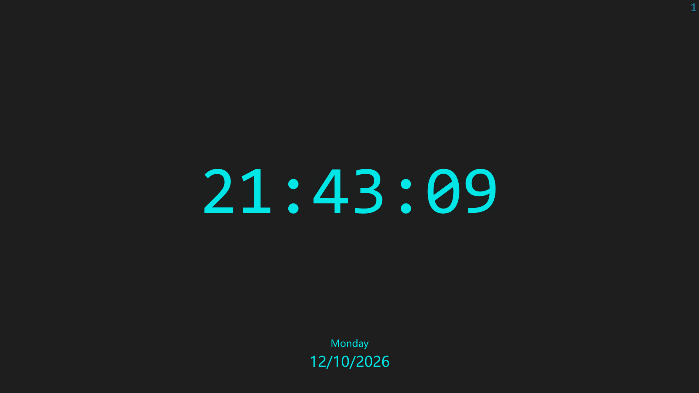

# QuickClock ⏱️

[English](README.md) | 简体中文


一个"按下快捷键,时间瞬间呈现"的全屏时钟。给它绑一个键盘快捷键,随手一按即看时间,按 <kbd>ESC</kbd> 或 <kbd>Q</kbd> 立即关闭。



## 为什么重写

原版 [QuickClock](https://github.com/ZXTube/QuickClock) 是 Python/pygame 应用——想法很好,但 Python 运行时让一个时钟变得太重:14–28 MB 的分发体积、一整条打包链路、能感知到的启动延迟。这是同一灵魂的 Rust 从零重写,没有那些负担:

| | Python 版 | QuickClock (Rust) |
|---|---|---|
| 分发体积 | 14.6 MB 单文件 / 28 MB 文件夹 | **单文件 0.72 MB** |
| 启动 | 解压临时目录、加载解释器 | **~瞬间** |
| 依赖 | Python + venv + PyInstaller | **无** |
| 空闲 CPU | 20 fps 事件循环 | **~0%**(每秒唤醒一次) |

## 功能

- ⏰ 时间 `HH:MM:SS`,Consolas 等宽字体居中显示——数字跳动不抖动
- 📅 日期与星期,微软雅黑,底部居中
- 🌏 始终本地时间(不会有 UTC 偏移的惊喜)
- 🖥️ 真全屏,DPI 感知的字号缩放
- 🔂 单实例——再次按快捷键是**唤起**已有窗口,而不是新开一个
- 🚀 无控制台窗口、无启动白闪、免安装

## 快速开始

从源码构建(Rust 工具链,MSVC):

```bash
cd rust
cargo build --release
```

产物在 `rust/target/release/QuickClock.exe`——单文件,零依赖,拷到哪都能跑。

**小技巧:** 在桌面放一个它的快捷方式,打开快捷方式属性,设置"快捷键"(如 <kbd>Ctrl</kbd>+<kbd>Alt</kbd>+<kbd>T</kbd>)。从此时钟一键即达,<kbd>ESC</kbd> 或 <kbd>Q</kbd> 一按即走。

## 设计要点

- **事件驱动渲染**——`winit` 精确在每个整秒边界唤醒,间隙零空转
- **软件渲染**——`softbuffer` + `ab_glyph` 光栅化:无 GPU 栈、无框架,每台机器上行为一致
- **字体回退链**——Consolas → Lucida Console;微软雅黑 → msyh.ttf → 黑体;全部失败才弹致命错误对话框
- **健壮的窗口生命周期**——隐藏创建、画完首帧才显示(无启动闪烁);瞬时表面故障跳帧重试而非崩溃

设计文档与实现计划见 [`docs/`](docs/)。

## 开发

```bash
cd rust
cargo test    # 13 个单元测试:时间格式化、字体回退、光栅化、布局
cargo run     # 调试构建
```

## 致谢

精神上 fork 自 [ZXTube/QuickClock](https://github.com/ZXTube/QuickClock)(Python/pygame)。Rust 实现为完全重写。

## 许可

[MIT](LICENSE) © 2026 zczsyqxl
